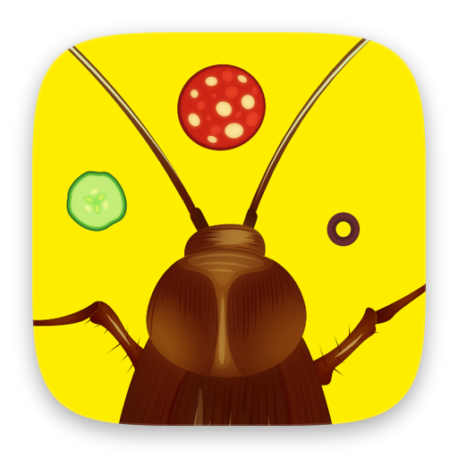

  

<h1 align="center">Snackroach</h1>

Guide a cockroach to the food gate in each of 69 levels, with as few taps as you can.

  
  &nbsp;
  
  &nbsp;
  

Godot 4 · GDScript · Steam · iOS · Android

## About the code

I wrote this version in 2024. It builds the Steam release and the mobile versions.

Art, sounds, fonts and third-party addons are not included, so the game can't be built from this repo.

© 2024 Indest OÜ. All rights reserved.
